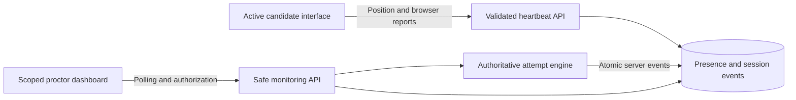

# Application architecture through Milestone 8

The repository contains a React/TypeScript/Vite frontend, a Python/FastAPI backend,
and PostgreSQL infrastructure. Domain management and the backend attempt engine
and the live candidate interface are implemented, including persistent answer
recovery and reconnection in Milestone 5, administration in Milestone 6, and scoped
proctor monitoring in Milestone 7, and grading/results in Milestone 8.

```text
cck-digital-test/
├── backend/
│   ├── app/
│   │   ├── main.py, config.py, cli.py, expiry_worker.py
│   │   ├── api/dependencies.py, api/routes/
│   │   ├── core/
│   │   ├── db/
│   │   ├── models/
│   │   ├── schemas/
│   │   └── services/
│   ├── alembic/versions/
│   ├── tests/
│   ├── pyproject.toml, requirements.lock, requirements-dev.lock
│   ├── alembic.ini, .env.example, Dockerfile
├── frontend/
│   ├── public/assets/cck/
│   ├── src/components/, data/, features/, pages/, services/, storage/, types/
│   ├── src/App.tsx, main.tsx, index.css
│   ├── tests/, e2e/, playwright.config.ts
│   ├── package.json, package-lock.json, .env.example, Dockerfile
├── docs/
├── docker-compose.yml, .env.example, .gitignore, README.md
└── .github/workflows/checks.yml
```

Alembic lives in one place, `backend/alembic/`; there is no second migration
directory under `app/db/`. Directories for future features will be created when
their milestone begins rather than adding empty modules.

The frontend includes presentational exam components, a protected live candidate
workflow in `features/exam/`, and an interactive development-only exam preview. Preview answers exist only in
page memory, its timer is paused, and Finish changes local UI state. It does not
implement backend attempts, timing, persistence, or scoring. See
[frontend structure](frontend-structure.md) for the complete source tree, route
behavior, and the three PNG assets.

The live workflow uses explicit typed contracts in `types/attempt.ts` and a
same-origin candidate API client in `services/exam.ts`. A per-account session
provider retains answer queues and monotonic deadline anchors across app navigation.
Queues debounce and serialize full revisioned answer/review snapshots, preserve
edits made during requests, and require an explicit choice after a stale-answer
conflict. Ambiguous network failures retry the exact original payload before a
newer edit. No local grades or browser deadlines are sent to the server.

The displayed timer uses `expires_at - server_time`, anchored to `performance.now()`.
Response transit time is conservatively deducted; revalidation cannot extend an
existing local anchor. The server remains authoritative. The client disables
edits at zero and polls authoritative attempt state before showing expiry receipts.
Submission flushes pending saves, requests closure, then reloads a server-confirmed
receipt. Result scores remain withheld/unimplemented. Milestone 5 uses native
IndexedDB and Web Locks without adding runtime dependencies or a PostgreSQL migration.
Playwright and fake-indexeddb are development test dependencies.

`storage/recovery.ts` journals confirmed revisions, local drafts, and exact pending
requests by verified user/attempt/subject. Each edit queues a local transaction;
network writes await its completion. A Web Lock gives one tab ownership of a
subject. Journal generations reject stale local writers; an account epoch prevents
open writers from recreating records after explicit logout clears them.

`createSession.ts` validates recovery data against fresh authenticated paper data.
The queue recognizes lost acknowledgements, restores eligible drafts, and surfaces
conflicts with newer server answers. Transient failures retry with exponential
backoff and jitter, capped at 30 seconds. Deadline and account checks precede each
send, including after a slow storage transaction. Cold reload requires network
access to restore authentication and server state; no offline authentication or
persisted client deadline is introduced. See [Milestone 5](milestone-5.md).

FastAPI routes coordinate typed requests and explicitly constructed responses.
Services perform credential verification, account linking, eligibility checks,
session creation, and exam-domain management. `admin_domain.py` coordinates routes;
`exam_domain_service.py` enforces draft-only editing, paper assembly, question
compatibility, and transactions. `exam_domain.py` schemas explicitly separate
administrator requests/responses from ORM models. `attempt_service.py` implements
assignment eligibility, one logical attempt, ordered subject starts, deadlines,
revision checks, submission, and expiry. Candidate routes use separate allowlisted
question/answer schemas. Backend dependencies provide authentication and role checks.
SQLAlchemy's synchronous PostgreSQL driver runs in FastAPI's worker thread pool.
There is no need for an async data layer for this foundation.

Candidate browser → roll number/full name/father's name → persistent login throttle →
approved admissions record lookup → opaque session cookie → protected `/api/me` → dashboard.
Staff retain Google Identity Services → verified ID token → preapproved staff lookup →
the same opaque session mechanism. Admission records are entered/imported by authorized
staff; no automatic admission-portal connection or roll-number generation is implemented.
React retains the profile and CSRF token in memory; it reloads `/me` on refresh.
Authentication tokens are not stored in browser persistent storage.

```mermaid
sequenceDiagram
    participant Candidate
    participant React
    participant FastAPI
    participant PostgreSQL
    Candidate->>React: Admission roll number and both names
    React->>FastAPI: POST /api/auth/candidate
    FastAPI->>PostgreSQL: Atomically reserve roll/IP login limits
    FastAPI->>PostgreSQL: Lock user and approved candidate; compare details
    alt Approved
        FastAPI->>PostgreSQL: Rotate session without changing attempts
        FastAPI-->>React: HttpOnly cookie and public profile
        React-->>Candidate: Protected dashboard
    else Not approved
        FastAPI-->>React: Access denied
        React-->>Candidate: Contact admissions
    end
```

For development, Vite proxies `/api` to FastAPI. Cookies and requests use the
frontend origin. Future production hosting must preserve this same-origin model
with an HTTPS reverse proxy. Docker Compose currently provides PostgreSQL only;
backend and frontend Dockerfiles are development building blocks, not a completed
production deployment.

Milestone 9 keeps that architecture. Bounded-body/security-header ASGI middleware
guards the HTTP boundary; `login_throttle_service` shares persistent sign-in limits
without touching answer transactions. Certificate caching affects only Google's
public signing certificates. Authentication appends minimal `security_events`;
PostgreSQL guards prevent history rewrites, with a separate runtime-role grant
template for deployment. Session expiry now uses the same database clock authority.
The operator-only `auth_maintenance` command prunes expired authentication data
without deleting exam/recovery/history records. See [security review](milestone-9.md).

There is one explicit role per user initially: CANDIDATE, ADMIN, PROCTOR, EXAMINER.
The trusted CLI provisions staff, including the first ADMIN. Authenticated ADMIN
users can now provision/edit/disable candidates and import registrations atomically.
ADMIN-only management APIs use Origin/CSRF protection on mutations. The separate
`features/admin/` frontend contains candidates, exams, subjects, questions, paper
builder, and staff action history. Its navigation uses the existing navy CCK brand.
Candidate preview never opens a privileged admin workspace. Candidate approval grants dashboard access;
exam access also requires an active assignment and administrator start authorization.
Schedules gate starts and impose a hard end when configured.

`admin_management_service.py` manages candidate identity/eligibility, publication,
and withheld-result planning. Identity or status edits revoke existing sessions.
Import rolls back the entire batch and its staff events if any row conflicts.
`api/admin_audit.py` attaches safe actor/action context to domain mutations; the
existing commit helper writes an action record atomically with a successful change.
There are no audit update/delete endpoints. Strong database-level immutability
remains later hardening work. Session events are implemented separately below.

Publication is separate from start authorization. Unpublished unstarted exams are
hidden from candidates. Existing attempts stay resumable and retain their deadlines,
while unpublishing disables new starts. Question keys remain ADMIN-only. Result
release requires paused starts, completed attempts, and completed grading. A date
alone never releases results; an ADMIN must authorize publication explicitly.
See [Milestone 8 handover](milestone-8.md).

`proctor_service.py` checks exam-specific proctor assignments; ADMIN can monitor
all exams. Its explicit schemas return names/roll numbers, subject/status, reported
position, contact freshness, expiry, and safe event types. They never return answer
content, prompts, options, grades, Google identities, or emails. Monitoring reads
reconcile expiry through the same attempt engine and commit its server events.
Attempt locks are acquired in UUID order when a monitoring page covers multiple
candidates. Proctors have read-only access and cannot authorize starts or edit tests.

Three new tables keep monitoring independent: `proctor_exam_assignments` grants
scope, `attempt_presence` stores the latest heartbeat, and `session_events` stores
allowlisted server/browser event context. Server transitions append events in the
same transaction as attempt/answer changes. Retry/idempotent actions do not create
duplicate transition events. Browser event nonces are unique within an attempt.

`features/proctor/` polls permitted exams/rosters/events without overlapping requests,
backs off on failures, labels stale snapshots, and clears data on access denial.
Its timers anchor server timestamps to monotonic elapsed time. Candidate
`PresenceReporter` sends position and bounded event batches separately from answer
saving; failure does not block exam work. Dashboard polls are about five seconds,
normal heartbeats ten seconds, and recent contact means no more than thirty seconds
since server receipt. There is no WebSocket/broker infrastructure in this milestone.
Load qualification can justify a later change without replacing the attempt engine.



Browser events remain untrusted observations for human review, not proof of
misconduct. See [Milestone 7 handover](milestone-7.md) for operational limits.

PostgreSQL's current clock supplies deadlines and timestamps. The engine reads
`clock_timestamp()` after obtaining row locks; transaction-start time would be
stale after lock waits. Candidate writes serialize per assignment/attempt, without
locking the whole exam for every answer. Initial exam/subject starts lock the exam
configuration, while existing attempts freeze edits. Shared subject catalog rows
are locked in UUID order during validation to avoid conflicting lock orders.

The expiry worker uses `FOR UPDATE SKIP LOCKED` on due exam attempts, then closes
their subjects. Multiple workers can coexist with candidate requests. API requests
also reconcile expiry; worker failure never extends write deadlines. The worker
must be supervised separately from the FastAPI process. The design uses PostgreSQL's
[row locking](https://www.postgresql.org/docs/current/explicit-locking.html) and
[current clock functions](https://www.postgresql.org/docs/current/functions-datetime.html).

Milestone sequence remains: foundation → exam domain → attempt engine → candidate
test UI → resilience → admin portal → proctors → grading/results → hardening →
production readiness. Proceed to the next milestone only on the project owner's instruction.

Milestone 8 adds `auto_grading_service.py`, `grading_service.py`, and
`result_service.py`. Automatic grading runs in the subject-close transaction and
bulk-loads private keys. Grading records reference raw answers without replacing
or normalizing their stored text. Completed-attempt backfill is an explicit admin
operation. Manual review locks exam → attempt → subject → answer and appends a
revision; examiner grants are checked while the exam lock is held. Publication,
withholding, manual grading, and examiner-grant writes share that exam lock.
Candidate result reads acquire exam locks in UUID order and omit every score
until both completed grading and authorized server-time release are confirmed.
No worker broker, frontend scoring, new runtime dependency, or exam-engine rewrite
was introduced. See `docs/milestone-8.md` for the complete contract.
