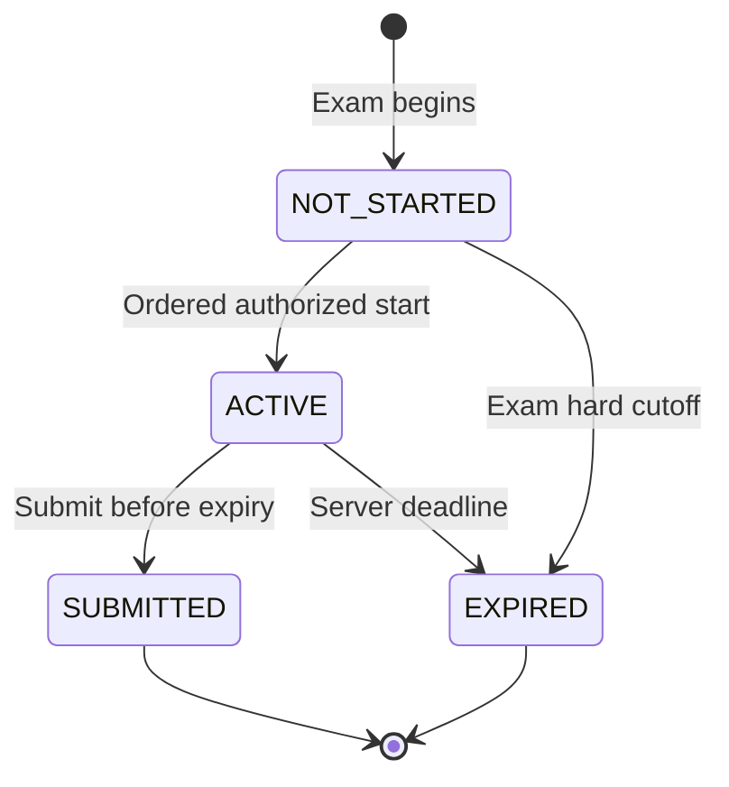

# Exam lifecycle through Milestone 5

The backend implements authorized starts, independent subject deadlines, saved
answers/review flags, submission, automatic expiry, and resume. Grading and results
remain later milestones. The supplied frontend templates use live backend state
and receipts, with IndexedDB recovery and reconnection. A separate development-only
layout preview keeps a paused timer and synthetic submission design.

The future flow is approved sign-in → assigned exam → instructions → readiness
check → waiting screen → authorized start → configured subject sequence → final
submission → confirmation → results only after administrative release.

Core invariants:

- Subject configuration, duration, and order belong to exam configuration.
- The backend controls timing and scoring; browser clocks cannot extend an attempt.
- Start/expiry/submission timestamps survive refresh and re-login.
- Submitted or expired subjects reject further writes.
- At most one logical candidate attempt exists per exam unless an authorized
  administrative process explicitly permits a retake.
- Answer retries cannot create duplicate logical answers; revisions prevent stale writes.
- Local recovery preserves work but never extends deadlines.
- Candidate APIs never reveal correct options, accepted answers, or grading keys.
- Exam-specific candidate assignment is checked server-side.
- Grades remain separate from raw answers; manual changes preserve history.
- Results are withheld until the server's release policy permits disclosure.
- Browser/session events assist human review and do not prove misconduct.

## Start authorization

An ADMIN assigns an approved candidate to an exam and explicitly enables
`is_start_authorized`. This is a minimal engine control, not the final publication
or test-day administration UI. Authorization validates every configured subject
has an active, valid, nonempty paper. Configuration freezes while authorized,
and remains frozen once an attempt exists. DRAFT is the editable domain status;
an explicitly authorized DRAFT may start. ARCHIVED exams cannot start.

Candidates must also satisfy any schedule. `scheduled_start` is inclusive and
`scheduled_end` is exclusive for starts. End is a hard cutoff for all subjects;
each expiry is `min(started_at + duration, scheduled_end)` when end is set.
Without a schedule, explicit authorization is required and each started subject
gets its full configured duration. Time between subjects consumes the global
window when configured; there is no separate break timer yet.

Disabling start authorization pauses new exam/subject starts, while an existing
active subject keeps its deadline and may save/submit. Revoking a candidate's
assignment denies that candidate's future access to the exam; it does not pause
expiry. Reassignment resumes the original attempt. No retakes/reset process exists.

## Attempt states

The exam attempt is IN_PROGRESS until every subject is SUBMITTED or EXPIRED,
then becomes SUBMITTED. The final submission endpoint returns its persisted
receipt and never skips unfinished subjects. Subject submission/start retries are
idempotent: timestamps remain fixed and closed subjects cannot reopen.

Opening the next subject is an explicit request after earlier subjects close.
Question content is delivered only after that subject has started, with no keys
or grading rules. Closed, previously started papers are readable for the owner,
but answer and review writes are rejected. Future/unstarted paper content is withheld.

Every answer includes an expected revision and full answer/review snapshot.
Changes increment revision; identical retries do not. Conflicting stale writes
return the candidate's current answer rather than overwrite it. Short answers
retain raw Unicode/whitespace and are limited to 500 characters; MCQs validate
the selected option belongs to that question.

API requests reconcile deadlines under row locks, including rejected late saves.
The independent expiry worker records closures when no requests arrive. Expired
subjects record the deadline as submitted_at, even if processed later. An
unstarted subject closed by the exam cutoff has no started_at and no answers.
The worker and APIs share the same expiry logic and database clock.

Publication, result release, grading, audit events, and proctor actions remain
later milestones. Keep the frontend templates when integrating these capabilities.

## Live candidate interface (Milestone 4)

The dashboard reads assigned metadata, including configurable subject cards.
Instructions/open-exam/start-subject are separate steps; merely visiting a page
never starts a subject. Live headers show only the current subject, with no selector
that could bypass subject order. Questions, review flags, and saved responses load
from the existing attempt after refresh. Answer changes appear immediately and
are debounced into serialized revisioned saves. Finish flushes the queue before
submission and refuses to proceed if any save is unresolved.

The timer is anchored to server timestamps and monotonic elapsed time rather than
the device date. At zero, editing stops immediately; the page requests authoritative
state. A connection failure cannot manufacture a submitted receipt. The server
and expiry worker close expired subjects independently of the UI.

The CCK confirmation reads the server state again, displays the persisted subject
submission time/question count, and offers the next ordered subject without
starting it automatically. When all subjects close, it confirms the persisted exam
submission; no scores are calculated or displayed. Unsynchronized changes at expiry
are disclosed and cannot be written after closure.

## Recovery and reconnection (Milestone 5)

Edits update the page immediately and queue a local IndexedDB transaction before
upload. The UI distinguishes local preservation, waiting for synchronization, and
server-confirmed saving. Temporary connection failures retry automatically with
bounded backoff. Refresh first reauthenticates and loads authoritative paper state,
then reconciles local drafts and any exact request whose acknowledgement was lost.
A newer conflicting server answer requires the candidate to choose which to keep.

Only one tab in a browser profile owns a subject's recovery journal. Closing that
tab releases ownership; another tab can retry. Deadline checks continue during
network loss. Reconnection after expiry obtains a server receipt and discloses
unsynchronized local changes without uploading them. Fully synchronized closed
copies are cleared. Explicit sign-out clears the account's local copies, so
candidates are advised to wait for Saved before signing out. A cold offline reload
cannot reopen an editable paper until authentication and server state are verified.
